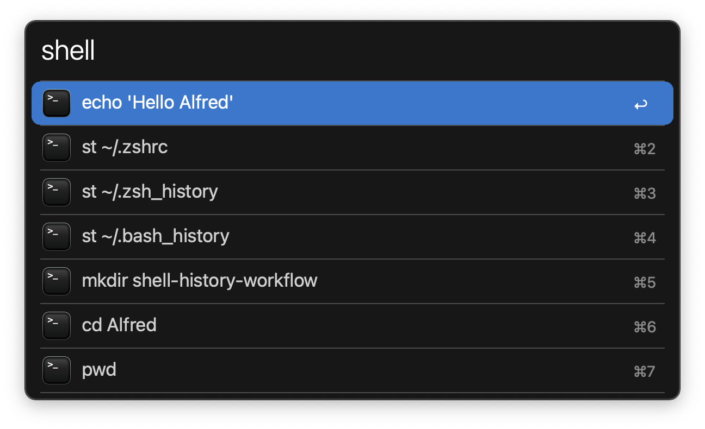

#  Shell History Alfred Workflow

Search your shell history with Alfred

[⤓ Download the workflow](https://github.com/iAli/shell-history-workflow/releases/latest)

## Usage

Search your zsh or bash shell history via the `shell` keyword.

* <kbd>↩</kbd>: Paste the command to the frontmost app.
* <kbd>⌘</kbd><kbd>C</kbd>: Copy the command to the clipboard.
